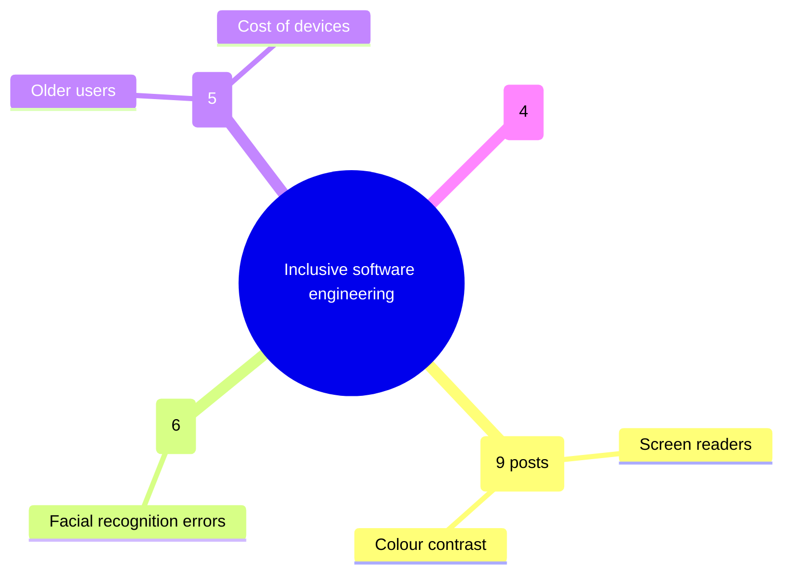

# CO3101 CW1 – Question 3: full guide

## What Question 3 is asking

Your class writes posts on a shared Padlet board about **inclusive software engineering**: how technology can help or exclude groups such as disabled, older, poorer or non-English-speaking people, or women. You:

1. give all the posts to **Copilot** and ask it to sort them into a small number of **themes**;
2. ask Copilot to turn those themes into a **picture**, usually a mind map;
3. write **200–300 words** with that picture in the middle, covering:
   - **Common themes:** what people talked about most, with **exact quotes** from the padlet and evidence that **agrees or disagrees** with them;
   - **Missing or unbalanced ideas:** what nobody mentioned, what got too many posts, and what got too few;
   - **How you used AI critically:** whether you checked Copilot's work, what it got wrong, and how you improved your prompts.

The marks are less about the themes themselves and more about showing you **did not blindly trust Copilot**.

---

## Step 1: Get the padlet posts ready

1. Open the padlet link from Blackboard and wait until most people have posted.
2. Export the posts with **Share → Export → CSV/Excel**. If export isn't available, copy and paste every post.
3. In a Word or Excel file, **number every post**: P1, P2, P3 … Numbered posts let you check exactly where Copilot put each one.
4. **Remove students' names**, which also protects their privacy. You can tell Copilot why in the video.
5. Keep this numbered list. You'll need it to check Copilot's work and to copy exact quotes.

## Step 2: Open Copilot

- Go to **copilot.microsoft.com**, or Copilot inside Edge or Microsoft 365, and **sign in with your university account**. The module says Copilot, so use that tool rather than ChatGPT.
- Start a **new chat** used only for this task, so the whole process is in one chat you can show in the video.

## Step 3: Prompts, in order (and why)

**Prompt 1: sort into themes**
> I am analysing posts from a class Padlet about inclusive software engineering. Below are all the posts, each numbered (P1, P2 …). Group them into 4 to 5 themes. For each theme give: a short name, a one-sentence description, the post numbers that belong to it, and how many posts that is. Every post must go into exactly one theme. Do not invent posts.
>
> [paste numbered posts]

**Check:** add up the counts. Do they equal your total number of posts? Is any post missing or listed twice? Do the themes describe the **real** posts or generic textbook ideas?

**Prompt 2: fix what's wrong (this prompt is evidence of critical AI use)**
> Theme X and theme Y overlap — merge them. Also, P7 is about older users, not accessibility; move it. List any posts that don't fit any theme.

Write down every correction you made. You need them for the "Critical use of AI" paragraph and for Figure 2.

**Prompt 3: quotes (only to help you find them)**
> For each theme, which post best represents it, and is there any post that disagrees with the others?

**Check:** find each suggested post in **your own list** and copy the quote from there, not from Copilot. Copilot sometimes rewords or invents quotes.

**Prompt 4: what's missing**
> Which groups of people or issues in inclusive software engineering are missing or only mentioned once in these posts? Which theme is overrepresented?

**Check:** is it actually true? Search your list. Example: if Copilot says nobody mentioned dyslexia, make sure nobody did.

**Prompt 5: the mind map**
> Create a mind map: centre node "Inclusive software engineering", one branch per theme (include post count), with 2–3 short leaf points per theme taken from the posts. Give it as Mermaid mindmap code.

Asking for code works better than asking Copilot to draw an image, because AI-drawn images often misspell words. Paste the code into **https://mermaid.live**, check it renders, and download it as **PNG**. It will look like this:

If Mermaid doesn't work, ask for the themes as a table and build the mind map yourself in PowerPoint (Insert → SmartArt) or draw.io. Say in the report that you did this.

## Step 4: Check everything Copilot gave you

Make a small table, which becomes **Figure 2** or goes in the video:

| Post | Copilot's theme | Our check | Correct? |
|---|---|---|---|
| P1 | Accessibility | Accessibility | ✔ |
| P7 | Accessibility | Digital divide (age) | ✘ moved |

Things that go wrong often and are worth mentioning:
- wrong post counts;
- a post put in the wrong theme;
- a theme or quote invented and not in the padlet;
- vague, generic themes.

## Step 5: Save the evidence

- Click **Share** in Copilot to get a chat link for reference [2]. If your university account blocks sharing, take screenshots or export the chat and say so in the references.
- Save the Mermaid code, the PNG and your checking table.
- Put the mind map in Figure 1 of `CW1-Question3.docx`, then fill in every yellow placeholder and remove the highlighting.

---

## Step 6: Your part of the group video (about 2–3 min)

Record your screen with Teams, PowerPoint or OBS:

1. **Intro (15 s):** "I did Question 3, the critical evaluation of the inclusive engineering padlet."
2. **Contribution (20 s):** what you did yourself: collected and numbered posts, ran Copilot, checked it, wrote the 262 words, made the figures. Also say anything you helped with on Q1 or Q2.
3. **Demo of the Copilot chat (60–90 s):** scroll through your real chat:
   - Prompt 1 and its first answer;
   - **what was wrong** with it, using your checking table;
   - Prompt 2, which fixed it;
   - the mind map code → mermaid.live → final picture.
4. **Findings (30 s):** the main themes, one quote, and what was missing.
5. **AI use statement (20 s):** "Copilot was used to group posts and make the mind map. I checked every post manually, corrected X mistakes, took all quotes from the padlet itself and found supporting evidence independently. Claude was used to help plan the structure and wording." Be honest. The brief requires every AI use to be declared.

Tips: rehearse once, keep the chat already open, zoom the browser to 125% so it's readable, and speak to what's on screen.

## Mistakes to avoid
- Copying Copilot's quotes without checking them against the padlet.
- Going over 300 words in the written answer.
- Forgetting the Copilot chat link or the AI declaration.
- Leaving any yellow placeholder in the final document.
- Hiding Copilot's mistakes. Showing them is what earns the marks.

## What you need from the rest of the group
Nothing from Q1 or Q2 feeds into Q3. The shared jobs: merge your references into the **one** group references page and renumber them, paste your Q3 page into the group template, and record your section of the group video.
